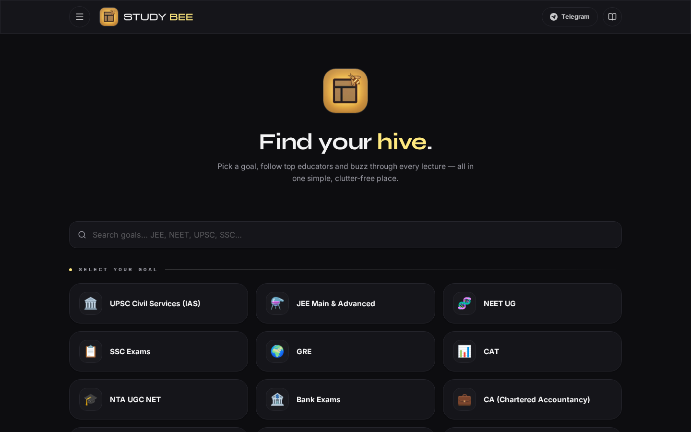
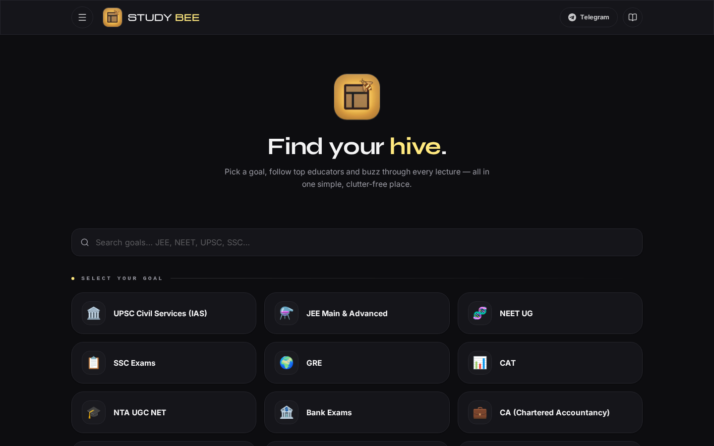
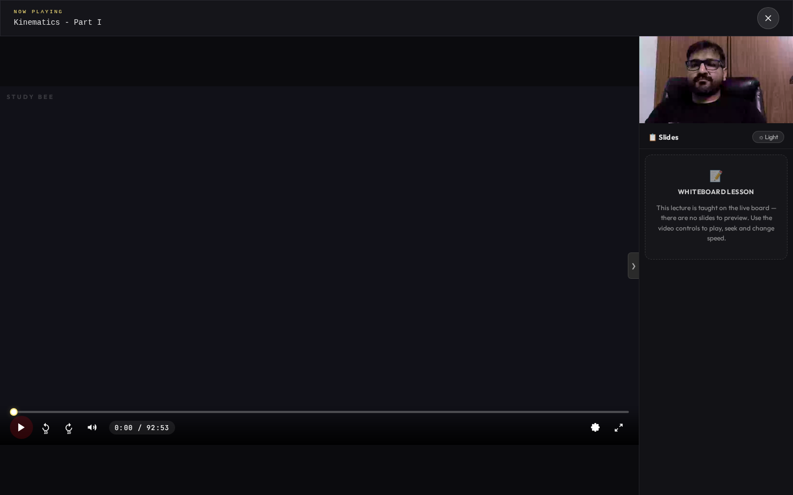
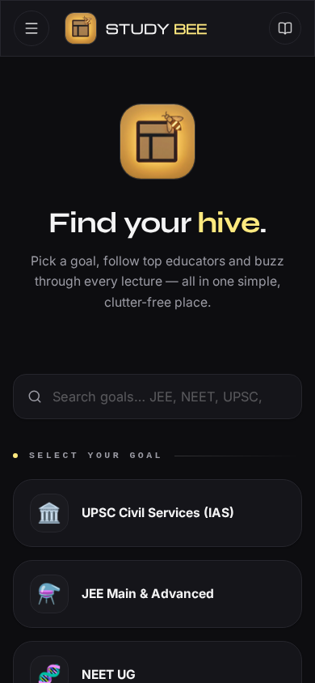

# Study Bee 🐝

A dark-themed, single-page lecture platform — browse exam goals, discover top educators, save favourites and watch lessons in a built-in player. Light-honey accents on a deep charcoal base, with a full mobile-first layout.

**Live demo:** [studybee-lecture-platform.vercel.app](https://studybee-lecture-platform.vercel.app)



| Goals grid | Lecture player | Mobile |
| --- | --- | --- |
|  |  |  |

---

## ✨ Features

- **Goal-based browsing** — 40+ exam goals (JEE, NEET, UPSC, CAT, GATE, SSC, state PSCs and more), each with its own icon and label.
- **Educator discovery** — teacher cards with avatars, follower counts, ratings, bios and verified credentials.
- **Search & filter** — instant client-side search across goals, educators and courses.
- **Favourites** — save educators and courses, persisted in `localStorage`.
- **In-app lecture player** — an embedded, self-contained player page with a draggable camera overlay, a doubts panel and a light/dark mode toggle.
- **Resilient data layer** — live data is fetched at runtime, with a bundled offline snapshot (`fallbackData.ts`) so the UI never renders empty.
- **Motion & polish** — `framer-motion` transitions, `lucide-react` iconography, Tailwind v4 theming via CSS custom properties.
- **Single-file output** — `vite-plugin-singlefile` inlines all JS and CSS into one `index.html`, so the built site is a single portable file.

## 🧱 Tech Stack

| Layer | Technology |
| --- | --- |
| UI | React 19.2 |
| Language | TypeScript 5.9 |
| Build | Vite 7.3 |
| Styling | Tailwind CSS v4 (`@tailwindcss/vite`) |
| Animation | framer-motion |
| Icons | lucide-react |
| Utilities | clsx, tailwind-merge |
| Hosting | Vercel |

## 📁 Project Structure

```
studybee-lecture-platform/
├── index.html            # App shell: fonts, favicon, theme tokens
├── package.json
├── tsconfig.json
├── vite.config.ts        # React + Tailwind + single-file plugins, "@" alias
├── vercel.json           # Vercel build config, SPA rewrites, headers
└── src/
    ├── main.tsx          # React root
    ├── App.tsx           # The whole single-page experience
    ├── index.css         # Tailwind import + design tokens (dark/honey theme)
    ├── playerAssets.ts    # Logo data-URI, API base, embedded player HTML
    ├── fallbackData.ts    # Bundled offline snapshot of teachers/courses/lectures
    └── utils/
        └── cn.ts          # clsx + tailwind-merge class helper
```

## 🚀 Getting Started

Requires **Node.js 20+**.

```bash
# install dependencies
npm install

# start the dev server (http://localhost:5173)
npm run dev

# production build → dist/
npm run build

# preview the production build locally
npm run preview
```

## 🔧 Configuration

Runtime endpoints and the embedded player markup live in `src/playerAssets.ts`:

| Export | Purpose |
| --- | --- |
| `SB_API_BASE` | Base URL for the data API |
| `SB_PLAYER_HTML` | Self-contained HTML document used for the lecture player |
| `LOGO_DATA_URL` | Inlined base64 logo |

Theme colours are declared as CSS custom properties in `src/index.css`:

```css
:root {
  --background: #0d0d10;   /* deep charcoal */
  --foreground: #f4f4f5;
  --primary:    #ffe97f;   /* honey */
  --card:       #15151a;
  --radius:     1rem;
}
```

Edit those tokens to re-skin the entire site — every Tailwind colour utility in the app derives from them via the `@theme inline` block.

## ☁️ Deployment

The repo is ready to deploy on Vercel with zero extra configuration. `vercel.json` pins the framework, build command and output directory.

**Via the dashboard**

1. Go to [vercel.com/new](https://vercel.com/new) and import `zarsagency-svg/studybee-lecture-platform`.
2. Framework preset **Vite** is detected automatically. Build `npm run build`, output `dist`.
3. Click **Deploy**.

**Via the CLI**

```bash
npm i -g vercel
vercel --prod
```

Every push to `main` triggers a production deployment; pull requests get their own preview URLs.

## 📜 Scripts

| Script | Description |
| --- | --- |
| `npm run dev` | Vite dev server with HMR |
| `npm run build` | Type-free production bundle into `dist/` |
| `npm run preview` | Serve the built bundle locally |

## 📝 Notes

- The build output is one large inlined `index.html` (~900 kB, ~240 kB gzipped) because of `vite-plugin-singlefile`. That is intentional for portability; remove the plugin from `vite.config.ts` if you prefer hashed asset splitting.
- `fallbackData.ts` and `playerAssets.ts` are sizeable because they embed a full offline data snapshot and the player document. They are imported at build time and bundled.
- This is a demo/clone project for educational and portfolio purposes. Educator data, media and trademarks belong to their respective owners.

## 📄 License

MIT — see the repository for details.
